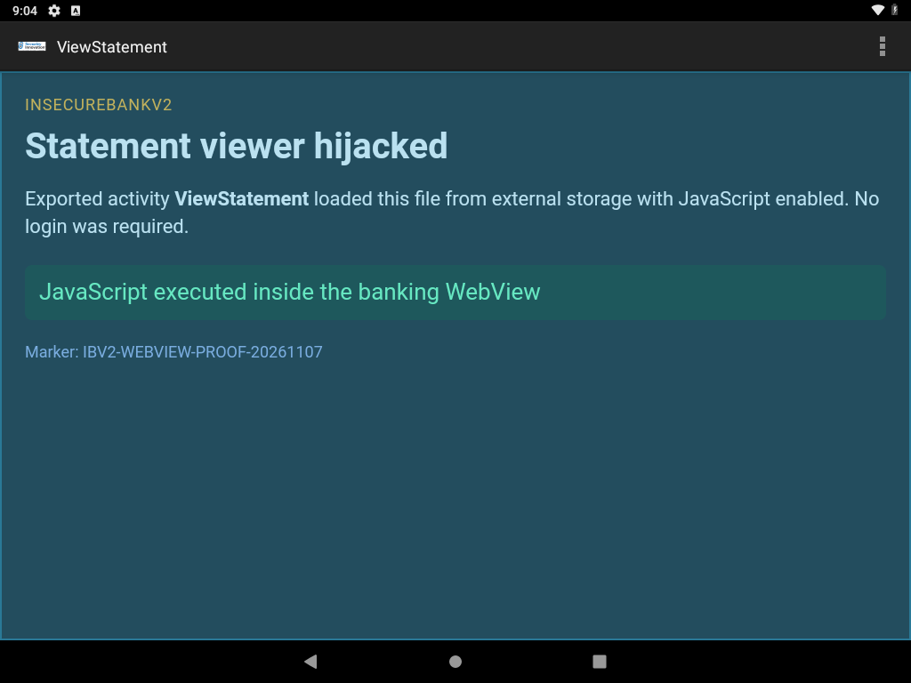

# Exported WebView loads attacker HTML with JavaScript

**Vulnerability title:** Exported `ViewStatement` WebView loads an attacker-controlled local file with JavaScript enabled

**Scanner title:** WebView JS Bridge (`WEBVIEW_JS_BRIDGE`)

**Scanner severity:** Critical

**Confirmed severity:** High

**Component:** `com.android.insecurebankv2.ViewStatement` (exported, no permission)

**Device:** VirtualBox Android 9 (API 28), `10.0.2.5:5555`, package `com.android.insecurebankv2`

## Description

The assessment report marked a Critical WebView JavaScript bridge because the DEX file contains the string `addJavascriptInterface`. That string sits in the DEX string pool next to other Android API names (`addFlags`, `addFragment`, `addHeader`). The app's own `ViewStatement` does not call `addJavascriptInterface`, and there is no `@JavascriptInterface` method. On API 28 that call would not have been remote code execution anyway.

What the activity actually does is still exploitable. It is exported. It reads the `uname` string extra and, if the file exists, loads:

```text
file:///storage/emulated/0/Statements_<uname>.html
```

with JavaScript enabled. Any caller who can write that file on shared external storage (the app holds `WRITE_EXTERNAL_STORAGE`, granted at install because `targetSdkVersion` is 22) can open the banking UI and run script in it without logging in.

The page used for this test starts with the text "JavaScript did not run". The script replaces that text. The screenshot shows the replacement, so the script ran inside the app's WebView.

## Steps performed

1. Confirmed `ViewStatement` is `android:exported="true"` and has no permission in the manifest.
2. Wrote an HTML proof file whose script changes its own status line.
3. Pushed it to `/sdcard/Statements_labproof.html`.
4. Woke the device and started the activity directly:

```bash
adb shell am start -n com.android.insecurebankv2/.ViewStatement --es uname labproof
```

5. Logcat printed the path the activity checked: `/storage/emulated/0/Statements_labproof.html`.
6. Captured the screen.

No login screen was shown. The activity title was `ViewStatement`.

## Evidence



On-screen text:

- Title: `ViewStatement`
- `Statement viewer hijacked`
- `JavaScript executed inside the banking WebView`
- `Marker: IBV2-WEBVIEW-PROOF-20261107`

The green status line is the text written by the page's script. The static HTML said "JavaScript did not run" until that script ran.

## Impact

Anyone who can start an activity on the device and write a file under external storage can present arbitrary content inside the banking app, with JavaScript running. That is a trusted-UI spoof and a local script-execution bug. It skips the login screen.

It is not native code execution. The WebView was not given a Java object, and the app does not turn on `setAllowUniversalAccessFromFileURLs`. A script in this page cannot read other files or call into the app's Java methods.

## Errors and fixes

**Scanner mismatch.** The Critical finding's evidence was the string `addJavascriptInterface`. Source review of `ViewStatement.java` shows `loadUrl`, `setJavaScriptEnabled(true)`, and a `WebViewClient` that loads every URL. It does not register a JavaScript interface. The exploit above is the bug that is actually present. Severity is reported as High for that confirmed behavior.

**No other error.** The activity loaded the file on the first attempt. `READ_EXTERNAL_STORAGE` is declared with `maxSdkVersion="18"`, but `WRITE_EXTERNAL_STORAGE` is granted at install on this `targetSdk 22` app, and the WebView was able to read `/sdcard/Statements_labproof.html`.
