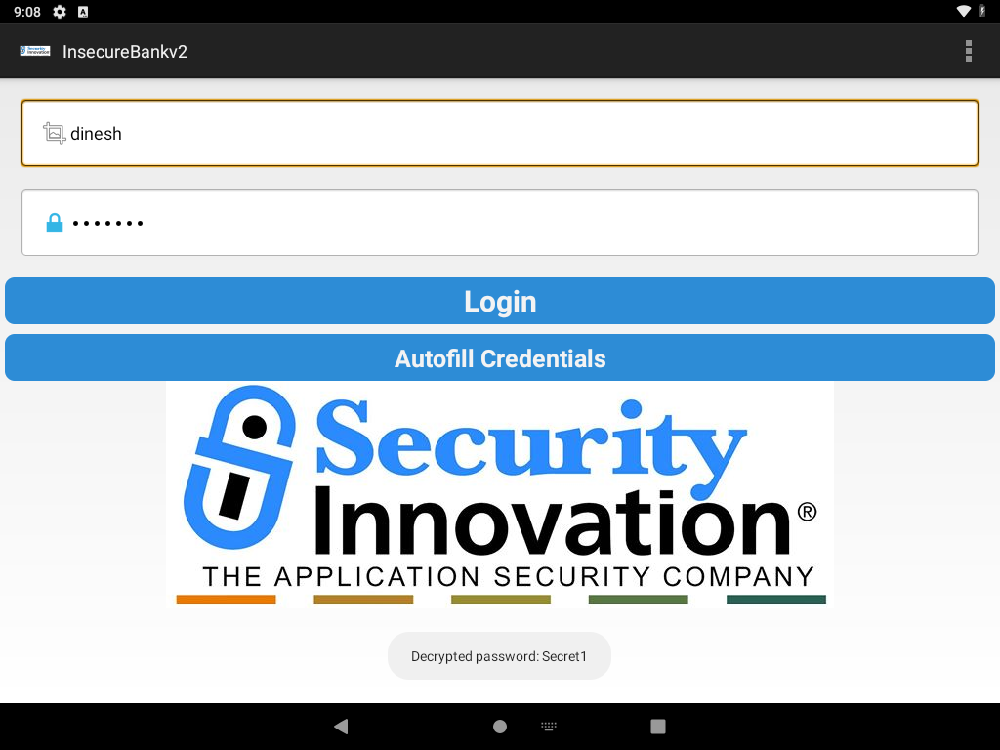
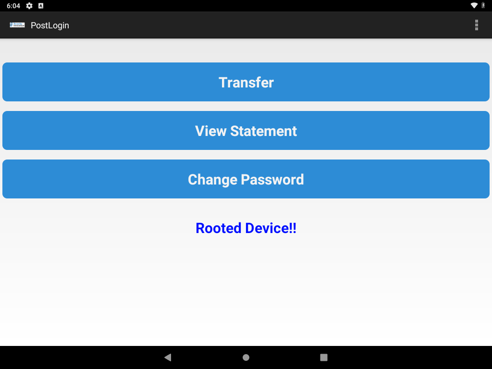

# Debuggable app exposes stored credentials, recoverable with a hardcoded AES key

**Vulnerability title:** `android:debuggable="true"` lets `run-as` read the private credential file. The password is AES-encrypted with a key hardcoded in the app.

**Scanner title:** Application is debuggable (`MANIFEST_DEBUGGABLE`)

**Scanner severity:** High

**Confirmed severity:** High. The hardcoded key was not in the scanner output. Together with the debuggable flag it recovers the stored account password.

**Component:** `AndroidManifest.xml` (`android:debuggable="true"`), `shared_prefs/mySharedPreferences.xml`, `com.android.insecurebankv2.CryptoClass`

**Device:** VirtualBox Android 9 (API 28), `10.0.2.5:5555`

## Description

`android:debuggable="true"` allows the shell user to enter the app uid with `adb shell run-as com.android.insecurebankv2` without root. That reads files under `/data/data/com.android.insecurebankv2/` that other apps cannot read.

After a login, `DoLogin.saveCreds()` writes `mySharedPreferences.xml`:

- `EncryptedUsername` is the username encoded with `Base64` (flag `CRLF`).
- `superSecurePassword` is the password encrypted by `CryptoClass`.

`CryptoClass` uses `AES/CBC/PKCS5Padding`, IV bytes of all zeros, and this 32-byte key from the class:

```text
This is the super secret key 123
```

Anyone who can pull the APK can read that key. Anyone who can `run-as` (or who has root, or a backup) can read the file. The two together return the plaintext password. The login path also logs it:

```text
Successful Login:: , account=dinesh:Secret1
```

## Steps performed

1. Confirmed `run-as` works as the app uid and does not use `su`:

```text
uid=10077(u0_a77) gid=10077(u0_a77) ... context=u:r:untrusted_app_25:s0:c512,c768
```

2. The credential file did not exist yet. The app only creates it after a successful login, and login posts to the server IP stored in preferences. That path had two lab problems, both fixed below, and a local stub answered `POST /login` with the body `Correct Credentials`. The app treats that substring as success and then stores whatever password was submitted.
3. Logged in through the real login screen as `dinesh` / `Secret1`.
4. Read the private file with `run-as`, not `su`:

```bash
adb exec-out run-as com.android.insecurebankv2 cat shared_prefs/mySharedPreferences.xml
```

5. Base64-decoded the username and decrypted the password with OpenSSL using the key and IV from `CryptoClass`.
6. Attached Frida, hooked `CryptoClass.aesDeccryptedString`, and tapped **Autofill Credentials**. The app decrypted the file and the hook showed the plaintext in a toast.

`automated_exploitations/03_debuggable_credentials.py` repeats this. On a later run the credential file was removed and the script created it again, including the proxy workaround.

## Evidence

Private file (`run-as` output):

```xml
<?xml version='1.0' encoding='utf-8' standalone='yes' ?>
<map>
    <string name="superSecurePassword">8QnuBKkw9irGGem0DR4A1g==&#10;    </string>
    <string name="EncryptedUsername">ZGluZXNo&#13;&#10;    </string>
</map>
```

Recovered values:

| Field | Value |
| --- | --- |
| Username | `dinesh` (`ZGluZXNo` is Base64) |
| Ciphertext | `8QnuBKkw9irGGem0DR4A1g==` |
| AES key | `This is the super secret key 123` |
| IV | 16 zero bytes |
| Password | `Secret1` |

Frida, on the Autofill button:

```text
KEY=This is the super secret key 123
CIPHER=8QnuBKkw9irGGem0DR4A1g==
PLAIN=Secret1
```



The username field contains `dinesh`. The password field is masked (seven dots). The toast at the bottom says `Decrypted password: Secret1`.



The post-login screen shows Transfer, View Statement, Change Password, and the text `Rooted Device!!`. The root check ran and detected this image (`/system/xbin/which su` resolves `su`). It only changes that label. It does not block those buttons. The scanner's root-detection items are Info findings about the check existing. They were not one of the three exploited issues, and no bypass was required to reach the credential file.

Saved copies:

- `automated_exploitations/evidence/03_mySharedPreferences.xml`
- `exploitation_reports/evidence/03_frida_decrypt.txt`

## Impact

A person with ADB access to this device, without root, can read the stored account password. The same file is also what `MyBroadCastReceiver` decrypts when it builds an SMS body. That receiver was not invoked in this test, so no SMS was sent.

The password recovered here is the lab account created for this exercise (`Secret1`), stored by the app's own `saveCreds()` path.

## Errors and fixes

**Login went to `10.0.2.2:8080` and was refused.** Logcat:

```text
org.apache.http.conn.HttpHostConnectException: Connection to http://10.0.2.2:8080 refused
```

The app's saved server was `10.0.2.2:8888`, not port 8080. The device global proxy was `http_proxy=10.0.2.2:8080`. Apache HttpClient sends the login through that proxy. Nothing was listening: `wget` from the device to `10.0.2.2:8888` and `:8080` returned `Connection refused`. `10.0.2.2` answers ping on this VirtualBox network and does not accept those TCP ports. The host that does is `10.0.2.4`.

`settings delete global http_proxy` left the app still connecting to `10.0.2.2:8080`. This works:

```bash
adb shell settings put global http_proxy :0
```

The script saves the previous proxy, sets `:0` only when that proxy is unreachable, logs in, and restores it. After the run, `settings get global http_proxy` was `10.0.2.2:8080` again.

The server preference was changed from `10.0.2.2` to `10.0.2.4`, port `8888`, so the device can reach the stub. The original file is `exploitation_reports/evidence/original_server_prefs.xml`. `run-as cp` was able to write the new file because the app is debuggable. Root was not required.

**Frida: `Java` is not defined.** Host Frida is 17.23.3 and `frida-server` on the device is 17.24.1. Enumerating the device and attaching succeeded across that skew. Loading a script that calls `Java.perform` failed immediately:

```text
ReferenceError: 'Java' is not defined
```

Frida 17 does not ship the Java bridge inside the agent. Fix: `crypto_watch.js` imports `frida-java-bridge`, and `frida.Compiler` bundles it to `frida/crypto_watch.bundle.js`. The Python script loads that bundle. After that, the hook printed the key and `Secret1`.

**`adb exec-out run-as ... cat` exits 0 when the file is missing.** The stderr text `No such file or directory` came back with a zero status, so the first version of the script tried to parse it as XML and raised `KeyError: EncryptedUsername`. Fix: treat a missing `<map>` or the text `No such file` as "no credential file" and run the login seed.
