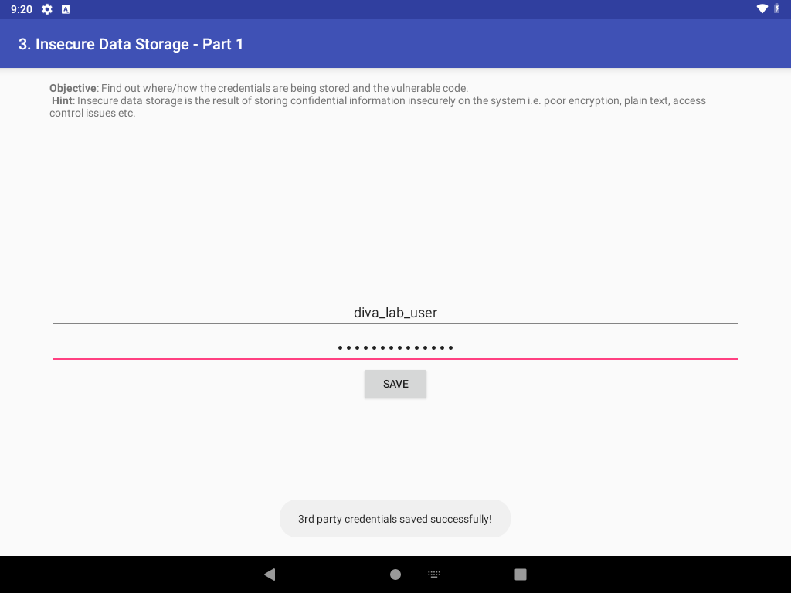
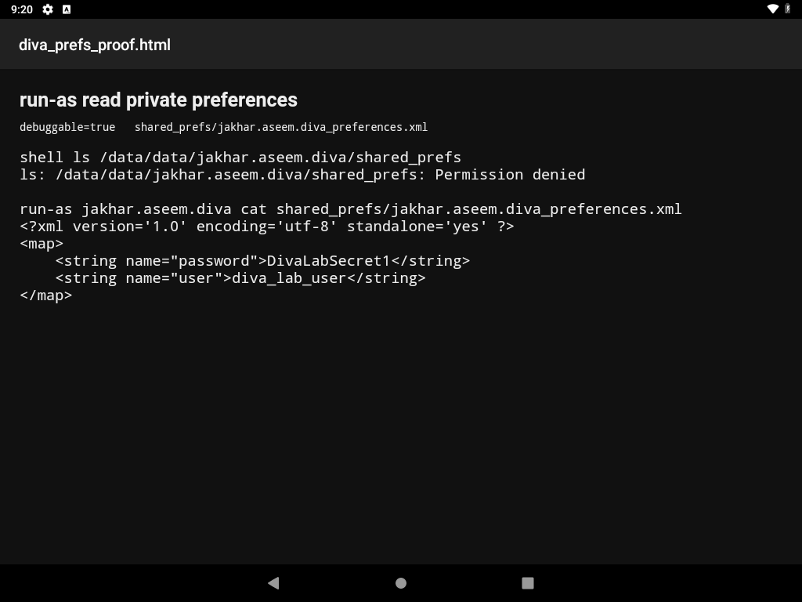

# Debuggable app exposes plaintext third-party credentials through run-as

**Vulnerability title:** `android:debuggable="true"` lets `run-as` read private SharedPreferences

**Scanner title:** Application is debuggable (`MANIFEST_DEBUGGABLE`)

**Severity:** High (confirmed)

**CWE:** CWE-489 (leftover debug code), CWE-312 (cleartext storage of credentials)

**MASVS:** MASVS-RESILIENCE-2

**Component:** `jakhar.aseem.diva.InsecureDataStorage1Activity`

**File read:** `/data/data/jakhar.aseem.diva/shared_prefs/jakhar.aseem.diva_preferences.xml`

**Device:** VirtualBox Android 9 (API 28), `10.0.2.5:5555`

## Description

The application tag sets `android:debuggable="true"`. On a device with ADB, that flag lets the shell user enter the app's private directory with `run-as jakhar.aseem.diva`. The same directory is denied to the shell user without `run-as`.

`InsecureDataStorage1Activity.saveCredentials()` writes the third-party username and password with `PreferenceManager.getDefaultSharedPreferences()`:

```java
spedit.putString("user", usr.getText().toString());
spedit.putString("password", pwd.getText().toString());
spedit.commit();
```

There is no encryption. The default file name is `jakhar.aseem.diva_preferences.xml`. The activity that shows this form is not exported, so the credentials were entered through the app UI, then read back from outside the app with `run-as`. Root was not used.

## Steps performed

1. Confirmed `android:debuggable="true"` in the manifest and read `saveCredentials()` in `InsecureDataStorage1Activity.java`.
2. Confirmed a plain shell cannot list the preferences directory:

```bash
adb shell ls /data/data/jakhar.aseem.diva/shared_prefs
# ls: /data/data/jakhar.aseem.diva/shared_prefs: Permission denied
```

3. Launched `MainActivity` and tapped **3. INSECURE DATA STORAGE - PART 1**.
4. Entered `diva_lab_user` / `DivaLabSecret1` and tapped **SAVE**. The screen showed "3rd party credentials saved successfully!".
5. Read the private file as the app user:

```bash
adb shell run-as jakhar.aseem.diva cat shared_prefs/jakhar.aseem.diva_preferences.xml
```

6. Opened that output in the device HTML viewer and took a screenshot.

The same steps are `automated_exploitations_diva/02_debuggable_private_storage.py`.

## Evidence

Form after SAVE, with the username still on screen and the success toast visible:



Private file, readable only because the app is debuggable:

```xml
<?xml version='1.0' encoding='utf-8' standalone='yes' ?>
<map>
    <string name="password">DivaLabSecret1</string>
    <string name="user">diva_lab_user</string>
</map>
```

Saved copy: `automated_exploitations_diva/evidence/02_preferences.xml`



## Impact

Anyone with ADB access to the device, and no root, can read credentials the user saved in this screen. The shell user is denied the same path, so the result depends on `debuggable`, not on the lab image being rooted. The password is the same string the user typed.

## Errors

**What failed:** Starting the storage screen directly was denied.

```text
adb shell am start -n jakhar.aseem.diva/.InsecureDataStorage1Activity

Security exception: Permission Denial: starting Intent
{ flg=0x10000000 cmp=jakhar.aseem.diva/.InsecureDataStorage1Activity }
from null (pid=8449, uid=2000) not exported from uid 10078
```

`InsecureDataStorage1Activity` has no intent-filter and no `android:exported="true"`. On API 28 the shell user cannot start it.

**Fix:** Open the exported launcher and tap the button the app itself uses. `MainActivity.startChallenge()` starts `InsecureDataStorage1Activity` when the view is `d3button`, whose label is `3. INSECURE DATA STORAGE - PART 1`. The script finds that label with `uiautomator` and taps it. It does not hard-code screen coordinates.

No other command failed. `run-as` succeeded on the first try. Frida was not required.
