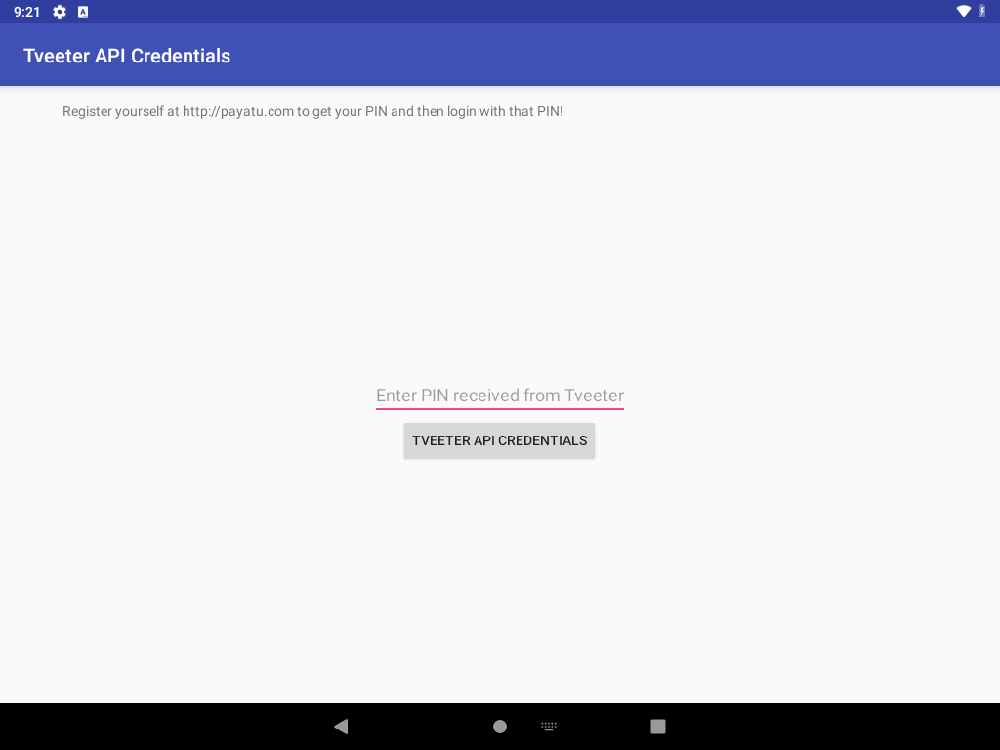
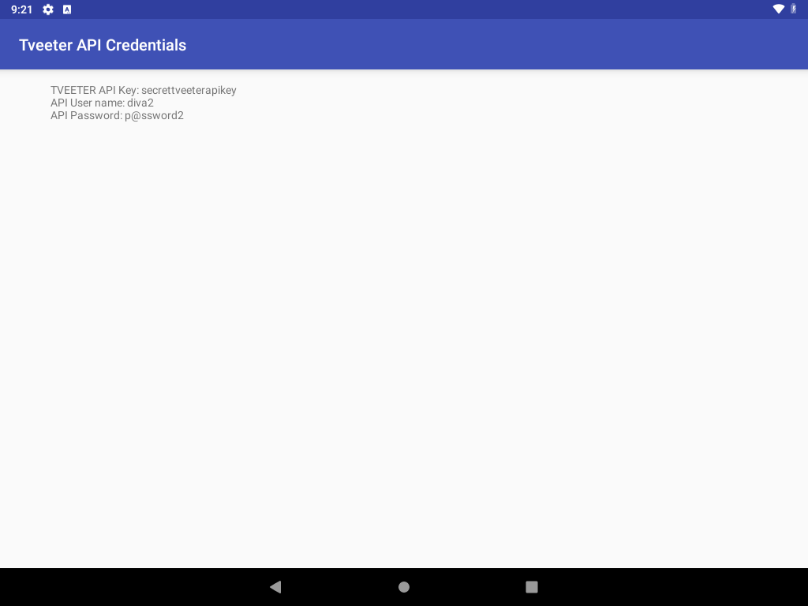

# Exported Tveeter activity reveals API credentials when check_pin is false

**Vulnerability title:** `APICreds2Activity` is exported and trusts a caller-supplied `check_pin` extra

**Scanner title:** Exported activity (`COMPONENT_ACTIVITY`)

**Severity:** Medium in the scanner. Confirmed impact is disclosure of the API key, username, and password.

**CWE:** CWE-926 (improperly exported component), CWE-807 (reliance on untrusted input for a security decision), CWE-798 (hardcoded credentials)

**MASVS:** MASVS-PLATFORM-1

**Component:** `jakhar.aseem.diva.APICreds2Activity`

**Intent action:** `jakhar.aseem.diva.action.VIEW_CREDS2`

**Device:** VirtualBox Android 9 (API 28), `10.0.2.5:5555`

## Description

`APICreds2Activity` has an intent-filter for `jakhar.aseem.diva.action.VIEW_CREDS2` and `android.intent.category.DEFAULT`. The app targets SDK 23 and does not set `android:exported="false"`, so the activity is exported. Any app can start it with an implicit intent.

`AccessControl2Activity` is the in-app screen. It sends `VIEW_CREDS2` and puts a boolean extra, `check_pin` (`R.string.chk_pin`), set from a radio button. `APICreds2Activity` trusts that extra:

```java
boolean bcheck = i.getBooleanExtra(getString(R.string.chk_pin), true);
if (!bcheck) {
    apicview.setText("TVEETER API Key: secrettveeterapikey\nAPI User name: diva2\nAPI Password: p@ssword2");
    return;
}
```

The default is `true`, which shows a registration message and a PIN field. `viewCreds()` always toasts "Invalid PIN" and never reveals the secret. Sending `check_pin=false` skips that path in `onCreate` and prints the credentials. No PIN is checked.

## Steps performed

1. Confirmed the intent-filter in the manifest and read `APICreds2Activity.onCreate()` and `AccessControl2Activity.viewAPICredentials()`.
2. Force-stopped the app so the next start would run `onCreate`.
3. Sent the implicit intent with no extra. The screen showed the registration wall and did not show the API key:

```bash
adb shell am start -a jakhar.aseem.diva.action.VIEW_CREDS2 \
  -c android.intent.category.DEFAULT
```

4. Force-stopped again and sent the same intent with the extra set to false. No component name was used:

```bash
adb shell am start -a jakhar.aseem.diva.action.VIEW_CREDS2 \
  -c android.intent.category.DEFAULT \
  --ez check_pin false
```

5. Read the on-screen text with `uiautomator` and took screenshots of both states.

The same steps are `automated_exploitations_diva/03_exported_apicreds2.py`.

## Evidence

Registration wall when the extra is omitted:



Same activity after `--ez check_pin false`:



Text captured from the screen:

```text
===== no extra (registration wall) =====
Tveeter API Credentials
Register yourself at http://payatu.com to get your PIN and then login with that PIN!
Enter PIN received from Tveeter
TVEETER API CREDENTIALS

===== --ez check_pin false =====
Tveeter API Credentials
TVEETER API Key: secrettveeterapikey
API User name: diva2
API Password: p@ssword2
```

Saved copy: `automated_exploitations_diva/evidence/03_apicreds2_screen.txt`

## Impact

Any application on the device can display, and therefore read, the Tveeter API key `secrettveeterapikey`, username `diva2`, and password `p@ssword2`. The user does not have to open DIVA or enter a PIN. The PIN button on the wall does not protect the values, because the decision is a boolean the caller supplies.

## Errors

None. The implicit intent resolved to `APICreds2Activity` on the first try, both without the extra and with `--ez check_pin false`. The script force-stops the app before each launch so Android delivers the new intent to `onCreate` instead of reusing a screen that was already drawn. Frida was not required.
